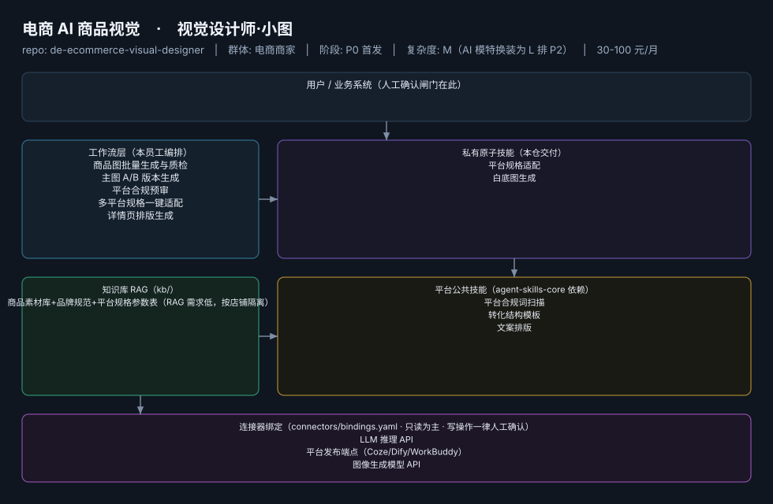

# 电商 AI 商品视觉

> 视觉设计师·小图 ｜ 一人店的"到岗美工"，只出能直接上架的合规商品图
>
> **视觉设计师·小图**　·　电商商家　·　阶段 P0 首发　·　
> 复杂度 M（AI 模特换装为 L 排 P2）　·　30-100 元/月　·　定义卡 6.4-①



## 效果（真实执行）


*上图为**真实效果对比**，不是示意图：左栏是输入材料与要求，右栏是该次执行的产出原文，
两栏取自同一次真实执行记录。*

- 完整台账：[`reports/real-run/wf-ecom-visual-compliance-precheck.md`](reports/real-run/wf-ecom-visual-compliance-precheck.md)
- 录屏与终端回放：[`workflows/wf-ecom-visual-compliance-precheck/docs/images/`](workflows/wf-ecom-visual-compliance-precheck/docs/images/)（`08-demo-run.gif` / `08-demo-run.mp4` / `04-terminal-run.png`）
- 使用示例：[`workflows/wf-ecom-visual-compliance-precheck/docs/使用示例.md`](workflows/wf-ecom-visual-compliance-precheck/docs/使用示例.md)
> 实测判定：**通过**　·　可用度 4/5　·　编造数字 0 处　·　红线命中 1 次 / 拦截 1 次


**一句话**：月上新 5-50 款的四平台一人店/夫妻店

---

## 这个数字员工解决什么问题

**闲鱼/淘宝适配**："主图模板包+合规词库"可做 ¥9.9-29.9 引流 SKU，自动发货零物流，天然匹配"单次 ≤¥300 验证"。

| 项 | 内容 |
|---|---|
| 服务对象 | 月上新 5-50 款的四平台一人店/夫妻店 |
| 可量化目标 | 一次过审率 ≥90%；单张交付 ≤5 分钟；返工率 ≤10% |
| 投入产出 | 月省约 21h≈¥630 + 替代外包 ¥300-1500/次 vs 月费 ≤¥100，当月回本 |
| 需求依据 | D01、D26 |
| 分发渠道 | GitHub、闲鱼/淘宝（钩子 SKU）、小红书、Coze扣子商店 |

## 30 秒上手

```bash
git clone <本仓库地址> && cd de-ecommerce-visual-designer
pip install pyyaml
python3 tests/run.py            # 先跑一遍自检，确认环境与契约都对得上
```

试用（把 `<输入>` 换成本人真实材料）：

```text
请以「电商 AI 商品视觉」的身份，帮我跑「商品图批量生成与质检」。
材料如下：<输入>
要求：只使用材料里出现过的数字，缺的写 <待填>；对外文案停在待确认状态。
```

详细接入见 [`docs/01-安装与接入.md`](docs/01-安装与接入.md)。

## 仓库结构

```text
de-ecommerce-visual-designer/
├── employee.yaml          # 机器契约（能力清单 + 依赖锁）
├── dependencies.yaml      # 对 core 的外部依赖（含版本）
├── persona/               # 运行提示词 / 边界 / KPI
├── skills/                # 私有原子技能（2 个）
├── spec-bindings/         # 有意不公共化能力的本地绑定声明（0 个）
├── workflows/             # 本员工工作流（5 条）
├── kb/                    # 知识库 RAG 契约
├── connectors/            # 连接器绑定（只读为主，写操作人工确认）
├── docs/                  # 六类发布文档
└── tests/                 # 自动化多场景测试
```

## 私有原子技能（2）

| 技能 | slug | 复杂度 | 阶段 | 成熟度 |
|---|---|---|---|---|
| `平台规格适配` | `platform-spec-adapter` | S | P1 | 已实现 |
| `白底图生成` | `white-bg-image` | M | P0 | 已实现 |

## 平台公共技能依赖（3）

| 技能 | slug | 全平台复用员工数 |
|---|---|---|
| `平台合规词扫描` | `compliance-word-scan` | 6 |
| `转化结构模板` | `conversion-structure-template` | 2 |
| `文案排版` | `copy-layout` | 2 |

> 这些技能来自 `agent-skills-core@1.0.0`，本仓库**只引用不复制**。

## Spec 绑定层（0）

（无）

> 这一族能力**有意不公共化**（与外部平台接口强绑定）。本仓不存正文，
> 只留本地绑定声明与连接器配置。

## 工作流（5）

| 工作流 | slug | 触发 | 阶段 | 调用技能数 |
|---|---|---|---|---|
| `商品图批量生成与质检` | `wf-ecom-visual-batch-gen-qc` | 人工 | P0 | 1 |
| `主图 A/B 版本生成` | `wf-ecom-visual-main-ab` | 人工 | P0 | 2 |
| `平台合规预审` | `wf-ecom-visual-compliance-precheck` | 事件（出图完成） | P0 | 1 |
| `多平台规格一键适配` | `wf-ecom-visual-spec-adapt` | 事件（新品上架） | P1 | 1 |
| `详情页排版生成` | `wf-ecom-visual-detail-page` | 人工 | P1 | 2 |

## 知识库与连接器

- 知识库语料：['商品素材库+品牌规范+平台规格参数表（RAG 需求低，按店铺隔离）']
- 连接器：LLM 推理 API、平台发布端点（Coze/Dify/WorkBuddy）、图像生成模型 API、OCR 文字识别

## 质量与验收

| 项 | 值 |
|---|---|
| 技能文件数 | 172 |
| 多场景用例数 | 209 |
| 用例通过 | 209 |
| 验收结论 | ✅ 通过 |

完整报告：[`docs/05-验收与测试.md`](docs/05-验收与测试.md)

## 许可

专有许可，详见 [`LICENSE`](LICENSE)。
