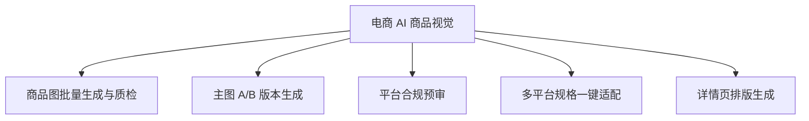

# 数字员工定义卡：电商 AI 商品视觉

> 遵循 [小班底数字员工资产规范](https://github.com/xiaobandi/digital-employee-spec) v1.0（12 主字段 + 2 扩展组）
> 本卡为人读快照，机器契约以 [`employee.yaml`](employee.yaml) 为准。

## A. 身份定义

| 字段 | 内容 |
|------|------|
| 名称 | **电商 AI 商品视觉** |
| 别名 / 旧名存档 | 视觉设计师·小图 |
| 一句话定位 | 视觉设计师·小图 ｜ 一人店的"到岗美工"，只出能直接上架的合规商品图 |
| 目标用户 | 月上新 5-50 款的四平台一人店/夫妻店 |
| 所属客群 | 电商商家 |
| 仓库 | `de-ecommerce-visual-designer` |
| 定义卡编号 | 6.4-① |
| 版本 | 1.0.0 |
| 阶段 | P0 首发 |
| 复杂度 | M（AI 模特换装为 L 排 P2） |

## B. 角色边界（做 / 不做）

| 做 | 不做 |
|----|------|
| 商品图生成、质检、合规预审、多平台适配 | 品牌 VI、仿冒与虚假功效图 |

## C. 目标与 KPI

一次过审率 ≥90%；单张交付 ≤5 分钟；返工率 ≤10%

## D. 工程与商业属性

| 字段 | 内容 |
|------|------|
| 评分 | 高频5｜痛点5｜客单价3｜广度5｜价值5 ＝ **23/25** |
| 定价 | 30-100 元/月 |
| 投入产出（ROI） | 月省约 21h≈¥630 + 替代外包 ¥300-1500/次 vs 月费 ≤¥100，当月回本 |
| 分发渠道 | GitHub、闲鱼/淘宝（钩子 SKU）、小红书、Coze扣子商店 |

## E. System Prompt

```text
"仅处理商品视觉任务；产出须经保真校验与合规扫描后才交付；拒绝侵权与夸大功效"
```

> 完整运行提示词见 [`persona/system-prompt.md`](persona/system-prompt.md)。

## F. 工作流清单（5 条）



| # | 工作流 | 名称 | 触发方式 | 阶段 | 调用技能 |
|---|--------|------|---------|------|---------|
| 1 | `wf-ecom-visual-batch-gen-qc` | 商品图批量生成与质检 | 人工 | P0 | white-bg-image |
| 2 | `wf-ecom-visual-main-ab` | 主图 A/B 版本生成 | 人工 | P0 | white-bg-image、copy-layout |
| 3 | `wf-ecom-visual-compliance-precheck` | 平台合规预审 | 事件（出图完成） | P0 | compliance-word-scan |
| 4 | `wf-ecom-visual-spec-adapt` | 多平台规格一键适配 | 事件（新品上架） | P1 | platform-spec-adapter |
| 5 | `wf-ecom-visual-detail-page` | 详情页排版生成 | 人工 | P1 | copy-layout、conversion-structure-template |

**步骤链路**：`wf-ecom-visual-batch-gen-qc`：素材→批量生成→保真校验→质检交付；`wf-ecom-visual-main-ab`：卖点→2-4 版主图→CTR 建议；`wf-ecom-visual-compliance-precheck`：图上文案 OCR→极限词检测→修改建议；`wf-ecom-visual-spec-adapt`：主素材→各平台尺寸/比例适配；`wf-ecom-visual-detail-page`：卖点结构化→版式模板→长图导出

## G. 技能清单（2 个私有）

| 技能 | 名称 | 成熟度 | 版本 |
|------|------|--------|------|
| `platform-spec-adapter` | 平台规格适配 | implemented | 1.0.0 |
| `white-bg-image` | 白底图生成 | implemented | 1.0.0 |

### 共享技能（挂载自公共底座）

| 技能 | 来源仓 | 版本 |
|---|---|---|
| `compliance-word-scan` | agent-skills-core | 1.0.0 |
| `conversion-structure-template` | agent-skills-core | 1.0.0 |
| `copy-layout` | agent-skills-core | 1.0.0 |

## H. 知识库与连接器

| 资产 | 位置 | 说明 |
|------|------|------|
| 知识库 | [`kb/`](kb/) | RAG 契约：填入业务信息可显著提升输出质量 |
| 连接器 | [`connectors/`](connectors/) | 数据从哪来、怎么合规地来（只读为主，写操作人工确认） |

## I. 需求溯源

| 字段 | 内容 |
|------|------|
| 需求编号 | D01、D26 |
| 需求支持度 | 中等 |
| 证据置信度 | 中｜D 表无商品图专属需求 ID，主依据为 R3 群体痛点 + SC2 商品图场景（3 源） |

## J. 可信三字段

| 字段 | 值 |
|------|-----|
| 需求支持度 | 中等 |
| 证据置信度 | 中｜D 表无商品图专属需求 ID，主依据为 R3 群体痛点 + SC2 商品图场景（3 源） |
| 使用边界 | 见 B 段（做 / 不做） |

---

*本卡由 `tools/upgrade_facade.py` 依定义卡规范自动生成，请勿手工编辑；改 `employee.yaml` 后重跑即可刷新。*
